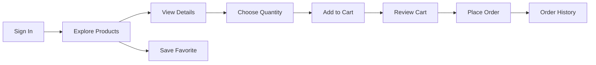
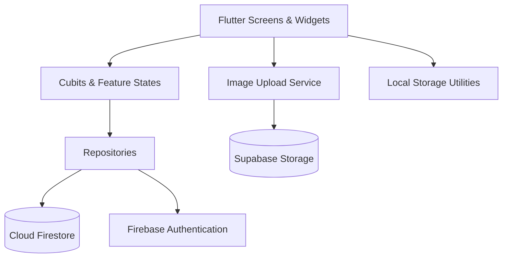

<div align="center">

# 🛍️ SHOPLY

### Discover. Explore. Save. Shop.

**A modern mobile shopping experience built with Flutter, Firebase, and Supabase.**

[](https://flutter.dev)
[](https://dart.dev)
[](https://firebase.google.com)
[](https://supabase.com)
[](https://pub.dev/packages/flutter_bloc)

[**Features**](#-features) · [**Tech Stack**](#-technology-stack) · [**Architecture**](#-architecture) · [**Getting Started**](#-getting-started) · [**Roadmap**](#-roadmap)

</div>

---

## 💡 Project Overview

**Shoply** is a Flutter e-commerce mobile application designed around a complete and intuitive shopping journey: discover products, browse categories, inspect product details, save favorites, manage a cart, and place orders.

Beyond its interface, Shoply demonstrates how a mobile application can connect **authentication, cloud data, state management, local session storage, image uploads, and reusable UI components** within a modular codebase.

The design follows a clean visual language: a signature **deep green (`#07583F`)**, spacious layouts, rounded product cards, readable typography, and purposeful motion that makes the experience feel responsive.

> **Vision:** Make online shopping simple for the customer and the codebase maintainable for the developer.

## 🎯 Objectives

- Deliver an end-to-end **product discovery → cart → order placement** experience.
- Use **Flutter and Dart** to create a consistent, mobile-first interface.
- Keep business logic separate from presentation using **Cubit/BLoC and repositories**.
- Use **Firebase Authentication** for user identities and **Cloud Firestore** for app data.
- Support user profiles and profile-image uploads through **Supabase Storage**.
- Improve usability with responsive feedback, loading states, error messages, and animations.
- Establish a foundation for testing, scalability, and future production enhancements.

## ✨ Features

| Module | Capabilities |
|---|---|
| 🔐 **Authentication** | User login/session handling, logout, account email verification workflow, and password-reset emails |
| 🏠 **Home** | Promotional banner, category shortcuts, and trending products |
| 🗂️ **Categories** | Browse and explore products by category |
| 📦 **Product Details** | Product images, description, price, quantity selection, and add-to-cart |
| ❤️ **Favorites** | User-specific favorites stored in Firestore with stream-based updates |
| 🛒 **Cart** | Add/remove products, adjust quantities, and calculate order totals |
| ✅ **Checkout** | Save order details to Firestore and clear the cart after saving |
| 🧾 **Order History** | View saved orders associated with the current user |
| 👤 **Profile** | Display account information, profile image, and number of orders |
| ⚙️ **Settings** | Update name, username, address, photo, email verification request, and password reset |
| 🧭 **Navigation** | Bottom tabs for Home, Categories, Favorites, and Cart, plus a navigation drawer |

### 🛍️ A Typical Shopping Journey



### 💳 What Checkout Means in This Project

Shoply currently implements **order placement**, not online payment processing. When a user checks out, the application builds an order record containing product information, quantities, prices, and total; writes that order to Firestore; and then clears the cart.

**No payment gateway or real-money transaction is claimed by this implementation.** Before production deployment, checkout also needs stronger server-side idempotency/atomicity to protect against a saved order followed by a failed cart clear.

## 🧰 Technology Stack

| Technology | How it fits |
|---|---|
| **Flutter & Dart** | Mobile application framework and programming language |
| **Material Design** | UI components and layout foundation |
| **flutter_bloc (Cubit)** | Reactive feature state and view-model logic |
| **Firebase Authentication** | Account authentication and user identity |
| **Cloud Firestore** | Product-related data, favorites, carts, profiles, and orders |
| **Supabase Flutter** | Cloud storage integration for profile pictures |
| **image_picker** | Selecting profile photos from the device |
| **shared_preferences** | Lightweight local preferences/session metadata |
| **flutter_secure_storage** | Secure local storage capability |
| **cached_network_image** | Network image caching and display utilities |
| **google_nav_bar** | Animated bottom navigation |
| **flutter_animate** | Declarative fade, slide, scale, and staggered effects |
| **animations** | Additional animation/transition primitives |
| **lottie** | Support for Lottie animations |
| **smooth_page_indicator** | Page indicator components |
| **dartz / pro_dialog** | Supporting utility and dialog packages |

These packages are declared in the project's `pubspec.yaml`. **A listed dependency does not imply that every screen uses it.**

## 🏗️ Architecture

Shoply uses **feature-based organization**, with screens and reusable widgets on the presentation side, **Cubits** for coordinating state, and **repositories/services** for data operations.



### Core Responsibilities

**Presentation:** Visual screens, product cards, cart controls, dialogs, navigation, and animated interactions.

**State Management:** Cubits track and emit states such as initial, loading, success, and error; views react using `BlocBuilder` and related BLoC tools.

**Repositories:** Dedicated classes handle fetching products, observing favorites/cart streams, modifying cart quantities, and saving orders.

**Shared Core:** Routing, local storage, common widgets, service initialization, and dependencies.

### Selected Project Layout

```text
shoply_app/
├── assets/
│   ├── images/
│   └── fonts/
├── lib/
│   ├── main.dart
│   ├── core/
│   │   ├── dependencies/
│   │   ├── local/
│   │   ├── model/
│   │   ├── navigation/
│   │   ├── repositories/
│   │   ├── routes/
│   │   ├── service/
│   │   └── utils/
│   └── features/
│       ├── app/
│       ├── home/
│       ├── categories/
│       ├── products/
│       ├── favorites/
│       ├── cart/
│       ├── orders/
│       ├── profile/
│       ├── settings/
│       └── about/
├── pubspec.yaml
└── README.md
```

The tree highlights key directories and may not include every file or authentication feature folder.

## ☁️ Firebase & Data Organization

Shoply associates user-specific records with the currently authenticated user's UID. The existing repository implementation uses this Firestore structure:

```text
User/
└── {uid}/
    ├── fullName
    ├── userName
    ├── address
    ├── profileImage
    ├── favorites/
    │   └── {productId}
    ├── cart/
    │   └── {productId}
    │       ├── quantity
    │       └── addedAt
    └── orders/
        └── {orderId}
            ├── items
            ├── total
            ├── status
            └── createdAt
```

- **Favorites:** Products are tracked by product ID; listeners can update the UI when Firestore changes.
- **Cart:** Each document represents a product and stores its quantity; adding an existing product increases the stored quantity.
- **Orders:** An order contains item snapshots, total, `status: placed`, and a Firestore server timestamp.
- **Profile image:** A URL returned by the Supabase upload service is saved in the user's Firestore profile record.

> **Security:** In any deployed environment, enforce appropriate Firestore security rules so users can only read and modify their own private data. Keep authentication credentials and service secrets out of source control.

## 🎬 UI/UX & Motion

Animations are intended to support the task, not distract from it.

**Core motion patterns and enhancements worked on during development:**

- Staggered fade/slide entrance effects for home and category content.
- Product image Hero transitions and product-card interaction feedback.
- Animated favorite-heart feedback.
- Product-gallery indicator transitions.
- Fly-to-Cart image motion and animated cart-badge concepts.
- Animated quantity counters and order-total changes.
- Swipe-to-delete with undo feedback for cart items.
- Checkout success feedback with an animated checkmark and confetti.
- Profile-photo and settings-screen entrance effects.
- Navigation and drawer transitions.

**Development status:** Some of the richer motion effects were provided as integration patches and require validation against the latest checked-out application. Do not treat all effects as tested or deployed unless they are present in the current branch and successfully run on a device. Respect reduced-motion accessibility settings wherever animations are used.

## 🚀 Getting Started

### Prerequisites

- Flutter SDK compatible with the project's Dart SDK requirement (`^3.12.2` in `pubspec.yaml`).
- Android Studio or Visual Studio Code with Flutter/Dart tooling.
- Android emulator, iOS simulator on macOS, or a physical device.
- A configured Firebase project with Authentication and Firestore.
- A Supabase project/storage configuration for profile photo uploads.

### 1. Clone the Repository

```bash
git clone https://github.com/yousefammmar/shoply_app.git
cd shoply_app
```

### 2. Install Dependencies

```bash
flutter pub get
```

### 3. Configure Cloud Services

The cloned project must be configured with **your own authorized Firebase and Supabase credentials** and the relevant Android/iOS application identifiers.

For Firebase, use the official FlutterFire configuration process for your Firebase project where needed:

```bash
dart pub global activate flutterfire_cli
flutterfire configure
```

Enable the authentication methods used by the application, configure Firestore, and set appropriate security rules. Set up the storage bucket and access rules expected by the existing Supabase image-upload service.

**Do not commit service-role keys, private tokens, or other credentials.** Firebase client configuration and Supabase public/anon/publishable client keys are different from privileged secrets; access control must still be enforced by backend security rules.

### 4. Run the Application

```bash
flutter devices
flutter run
```

### 5. Check Code Quality

```bash
dart format lib
flutter analyze
flutter test
```

These commands are recommended validation steps, **not a claim that all checks currently pass**.

## 🧪 Suggested Test Scenarios

1. Sign in and sign out, then reopen the app to check session handling.
2. Browse categories and open products with one or multiple images.
3. Add a product to favorites and confirm that it appears in the Favorites screen.
4. Add the same product to the cart more than once and verify the quantity increases.
5. Increase/decrease a quantity and verify the total is recalculated.
6. Remove a cart item and test any enabled Undo behavior.
7. Place an order and verify the saved order appears in Firestore and Order History.
8. Confirm that the cart is cleared only after the order is saved.
9. Test checkout network failures and rapid repeated button presses.
10. Update your profile details and photo; reopen the profile to verify persisted changes.
11. Test on different screen sizes and with reduced-motion accessibility settings.

## 🗺️ Roadmap

- [ ] Finish verifying all advanced animations against the current branch.
- [ ] Strengthen checkout with server-side idempotency and robust failure recovery.
- [ ] Expand widget, Cubit, repository, and integration test coverage.
- [ ] Improve offline/error-state handling and image-loading resilience.
- [ ] Add search, sorting, and richer product filters.
- [ ] Add a real payment provider **only if the project scope requires payments**.
- [ ] Prepare release builds and validate Firebase/Supabase security rules.

## 📚 What This Project Demonstrates

Shoply is also a hands-on software engineering exercise in:

- Translating product requirements into Flutter screens and reusable UI components.
- Structuring a growing app by features instead of accumulating code in one screen.
- Applying state management and separating UI logic from data access.
- Coordinating multiple backend services within one user experience.
- Designing reactive, accessible, and animated mobile interfaces.
- Handling asynchronous operations, validation, loading states, and failures.
- Iteratively improving code while preserving existing functionality.

## 🤝 Contributing

Contributions and constructive feedback are welcome. For significant changes, open an issue describing the problem or proposed improvement, and submit a pull request with a concise summary and any relevant tests.

## 📄 Project Status

**Educational / portfolio application — actively evolving.** The repository demonstrates an e-commerce order-placement workflow and modular Flutter development; it is not presented as a production-certified commerce or payment solution.

---

<div align="center">

### 💚 Built with Flutter. Powered by Firebase. Designed for a smoother shopping experience.

**SHOPLY — Discover. Explore. Save. Shop.**

[View the source on GitHub](https://github.com/yousefammmar/shoply_app)

</div>


# [App Logo](https://github.com/yousefammmar/shoply_app/issues/1)
# [Onboarding Screens](https://github.com/yousefammmar/shoply_app/issues/2)
# [Login Screen](https://github.com/yousefammmar/shoply_app/issues/3)
# [Forget Password Screen](https://github.com/yousefammmar/shoply_app/issues/4)
# [Create a New Account](https://github.com/yousefammmar/shoply_app/issues/5)
# [Unsuccessful Login](https://github.com/yousefammmar/shoply_app/issues/6)
# [Create Account Successfully](https://github.com/yousefammmar/shoply_app/issues/7)
# [Home Page](https://github.com/yousefammmar/shoply_app/issues/8)
# [Products](https://github.com/yousefammmar/shoply_app/issues/9)
# [Product Details Page](https://github.com/yousefammmar/shoply_app/issues/10)
# [Add to Cart](https://github.com/yousefammmar/shoply_app/issues/11)
# [Categories Screen](https://github.com/yousefammmar/shoply_app/issues/12)
# [Favorites Screen](https://github.com/yousefammmar/shoply_app/issues/13)
# [Cart Screen](https://github.com/yousefammmar/shoply_app/issues/14)
# [Remove from Cart](https://github.com/yousefammmar/shoply_app/issues/15)
### [Checkout](https://github.com/yousefammmar/shoply_app/issues/16)

